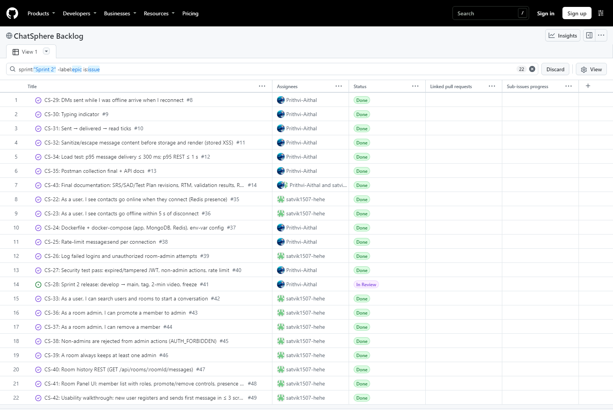
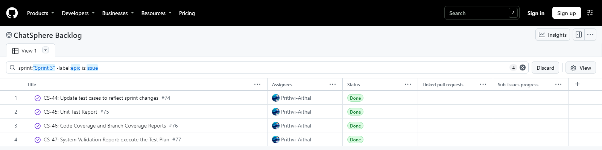

# Demo videos

| Video | Sprint | What it shows |
| --- | --- | --- |
| [sprint-1.mp4](sprint-1.mp4) (47 s) | Sprint 1 | Two users register and log in · Alice DMs Bob, who gets it instantly · after a reload the history is still there · Alice creates a room, Bob joins, both chat live · GitHub Actions and the Sprint 1 board |
| [sprint-2.mp4](sprint-2.mp4) (1 min 53 s) | Sprint 2 | Search to start a DM · typing indicator · sent → delivered → read ticks · offline delivery on reconnect · an HTML/script payload shown as plain text · room create/search/join · member panel with roles and presence · last-admin rule, promote and remove · presence offline within 5 s · CI, validation report and the Sprint 2 board |

Sprint 1 was recorded from the Sprint 1 release (tag `sprint-1`); Sprint 2 from the final build (tag `sprint-2`). Both use two automated browser sessions (Alice | Bob) side by side; captions describe each step.

Sprint 1 board at release: all Sprint 1 items Done except CS-08, the release itself.

Sprint 2 board at release: all Sprint 2 items Done except CS-28, the release itself.

Sprint 3 (spill-over and Part-3 testing): updated test cases and the unit test, coverage and system validation reports, all Done. Spill-over items from Sprints 1 and 2 are labelled `spillover` and were finished in this sprint (see `docs/DEVIATIONS.md`, D-08).
